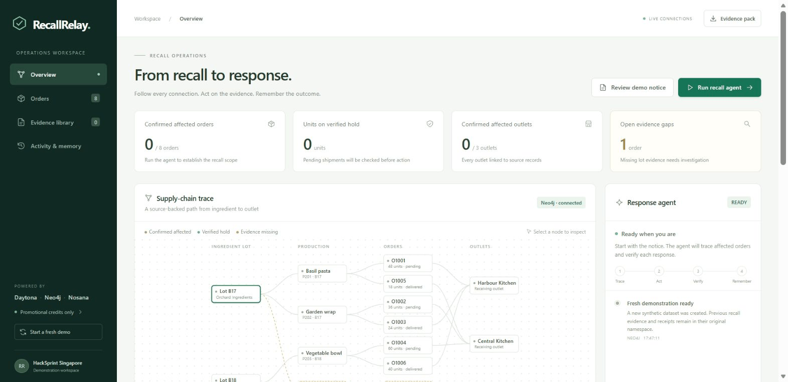
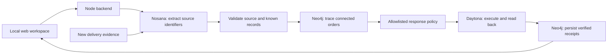

# RecallRelay

**Evidence-driven recall response with graph memory and verified execution.** Built for Daytona HackSprint Singapore.

**Find affected orders. Verify the response. Retain the evidence.**

### For judges: the result in 30 seconds

**New evidence adds a 32-unit shipment hold while reusing four previously verified actions.** The prototype traces a recalled ingredient through incomplete records, executes and verifies the response, then remembers what it has already done.

- **Watch without setup:** the recorded walkthrough below and [7-slide PDF deck](deck/RecallRelay-HackSprint.pdf) require no API keys or account setup.
- **Look for the feedback loop:** one unresolved lot connection becomes a confirmed connection; verified held units rise **84 → 116**; a recheck performs **zero new actions**.
- **Inspect the implementation:** live **Nosana → Neo4j → Daytona → Neo4j memory** integrations, [measured demo results](assets/demo-results.json), and [automated tests](https://github.com/Kennethlyw1/RecallRelay/actions/workflows/tests.yml).

All quantities come from a synthetic demonstration. Shipment holds change a simulated ledger; outlet notices remain drafts.

RecallRelay connects a supplier recall to downstream production batches, orders and receiving outlets. When a production record lacks an ingredient lot, the affected order remains unresolved. A new delivery note can establish that connection and automatically continue the response without repeating previously verified actions.

## Start here: the working demonstration

**[Presentation deck (PDF)](deck/RecallRelay-HackSprint.pdf)** · **[Editable PowerPoint](deck/RecallRelay-HackSprint.pptx)** · **[Submission description](SUBMISSION.md)**



Recorded screens from a fresh run with live sponsor services and synthetic data. The animation presents selected states with shortened timing. [Measured results](assets/demo-results.json) retain the actual observed timing.

The scenario begins with **4 confirmed affected orders and 1 unresolved delivery**. The agent verifies **84 units on shipment hold** and prepares **2 notices**. A new delivery note connects the unresolved production batch to the recalled lot. The response expands to **5 affected orders**, **116 units on verified hold** and **0 unresolved lot connections**. The next run reuses all **5 verified actions**.

This demonstrates a specific feedback loop: **source evidence → graph context → action → read-back verification → durable memory → revised response**. Document interpretation and tool execution use the live sponsor services; inventory and order-system data are synthetic.

### Evidence against the judging criteria

| Criterion | What the prototype demonstrates | Inspectable evidence |
|---|---|---|
| **Completeness** | A runnable interface, connected data, executed actions, read-back verification and downloadable evidence pack. | [Application orchestration](server.mjs), [interface](public/app.js), [setup](#run-locally), [tests](tests/domain.test.mjs). |
| **Innovation** | New evidence changes the affected network and triggers only the additional required action. Verified action memory prevents duplicates. | `evidenceFlow` / `runAgent` in [server.mjs](server.mjs); `connectEvidence` / `loadMemory` in [integrations.mjs](integrations.mjs). |
| **Real-life problem** | A food distributor or central kitchen must connect incomplete production and delivery records when a supplier recalls an ingredient lot. | [Original fictional records](fixtures/); [Singapore MSE discussion of swift, precise recalls and traceability](https://www.mse.gov.sg/latest-news/written-reply-to-parliamentary-question-on-product-recall---traceability-/). |
| **Sponsor technology** | Nosana interprets the source; Neo4j traces relationships and remembers verified outcomes; Daytona executes and verifies the response. | Live clients and receipt validation in [integrations.mjs](integrations.mjs); [architecture](#architecture). |

The prototype's scope is handling incomplete evidence and retaining verified response memory. It does not claim to invent food recall management, replace an enterprise traceability platform, or provide production regulatory compliance.

See [SUBMISSION.md](SUBMISSION.md) for the project description and 90-second demonstration script.

## Run locally

Requires Node.js 22 or newer and the three configured sponsor accounts.

```sh
npm install
cp .env.example .env
# Fill in your own credentials in .env
npm start
```

On this prepared Windows workspace, dependencies and `.env` are already configured. Run `./start.ps1` from PowerShell, or use `node server.mjs` from this directory.

Open **http://127.0.0.1:4317**. The backend listens on loopback only. API credentials stay on the backend and are excluded from the source archive and Git.

## Two-minute demonstration

1. Click **Start a fresh demo** if the current demonstration is already completed. This creates a new dataset namespace; it does not delete previous evidence.
2. Click **Run recall agent**. Nosana reads the fictional recall notice for basil sauce lot **B17**.
3. Watch the trace in Neo4j identify **4 affected orders across 2 outlets**, with **1 unresolved order**.
4. Daytona executes and verifies **2 shipment holds covering 84 units**, and prepares **2 outlet notice drafts** for already delivered orders.
5. Click **Add delivery note → Use demo delivery note → Verify & continue**.
6. The document explicitly confirms **B17 → P204 → O1007**. The agent adds **1 verified hold covering 32 units** for Airport Kitchen, reuses the previous **4 verified actions**, and closes the evidence gap.
7. Click **Recheck response**. The agent reuses all **5 verified actions** and performs no additional sandbox execution or model call.
8. Inspect **Activity & memory** and download the **Evidence pack**.

Final result: **5 affected orders, 3 receiving outlets, 116 units on verified hold, 2 notice drafts, and 0 unresolved lot connections**. Another 42 units had already been delivered and are covered by the notice drafts. The 3 orders for lot B18 remain outside this recall's scope.

## Sponsor integrations

| Service | Actual role in the working application |
|---|---|
| **Nosana** | Lists currently served chat models and calls the selected Qwen model through the live inference API. Extracts identifiers from the recall notice and delivery note. Model outputs are validated against source text and known records. |
| **Neo4j Aura** | Stores lots, production batches, orders, outlets, evidence, action memory and run history. Cypher queries traverse lot → batch → order → outlet. A missing relationship creates an unresolved case. New evidence creates the supported relationship. |
| **Daytona** | Runs allowlisted Python actions in an isolated sandbox. A synthetic order ledger is written atomically, then read back to verify shipment holds. Draft notices and idempotent action receipts are retained. The sandbox stops after each action run. |

The live integrations are real; **all supply-chain data and the order system are synthetic**. No supplier, regulator, customer or outlet is contacted. No live orders are changed. The system is a hackathon prototype, not a production recall or regulatory-compliance product.

## Architecture



The decision policy is deliberately bounded: hold confirmed affected pending shipments; prepare drafts for affected delivered orders; retain missing lineage as unresolved; skip verified actions by dataset, recall, order and action type. The model does not write Cypher or executable code.

## Credit controls

- Authorized ceiling: **US$1 of existing promotional credit per service**. No card, top-up, paid subscription or dedicated GPU deployment is configured.
- Nosana: **US$0.50 local reservation limit**, at most **20 calls**, 4,096 output tokens per call, source-length limits, and a price ceiling on eligible models. Each call reserves a conservative upper bound before it is sent. Failed requests retain the reservation.
- Daytona: **1 CPU, 1 GiB RAM, 3 GiB disk**. Each sandbox activation reserves 90 seconds against a **30-minute cumulative activation allowance**. A local timeout stops execution within that reservation, and the provider has a one-minute idle auto-stop. The sandbox also stops explicitly after each run and auto-archives after 60 stopped minutes.
- `data/usage.json` persists counters across app restarts and fresh demonstrations. The resource panel shows local estimated usage; provider dashboards remain the billing record.
- Controls apply to RecallRelay's activity. Other account workloads are outside the application's counters. Stopped sandbox disk storage can still have a small charge until archived; no new paid funds are enabled.

## Evidence and source data

`fixtures/` contains the initial fictional CSV records and both text documents. Source row references in the graph correspond to these files. New documents must identify a known batch, lot and order, and contain an explicit statement of the lot used by that batch. Conflicting assignments are rejected.

The downloadable JSON evidence pack contains the recall, trace, uploaded evidence, verified receipts, run summaries and activity log. It excludes credentials and does not claim to be a regulator-ready compliance submission.

Each fresh demo uses an independent namespace. Existing records elsewhere in the user's Neo4j database are not changed. Old RecallRelay demonstration namespaces are preserved.

## Validation

```sh
npm test
```

Domain tests check recall isolation, incomplete lineage, hallucinated identifiers, conflicting evidence, incremental response, idempotency, delivered-order handling and held-unit totals.

Live browser testing additionally verified Nosana document interpretation, Neo4j traversal and evidence writes, Daytona ledger execution/read-back, sandbox stopping, incremental action reuse and a repeat run with no new actions.

## Files

- `server.mjs`: local HTTP routes and bounded agent orchestration.
- `integrations.mjs`: sponsor API clients, durable memory and resource guards.
- `domain.mjs`: synthetic fixtures, validation and action policy.
- `public/`: responsive interface and interactive SVG supply-chain graph.
- `fixtures/`: source records and documents.
- `tests/`: domain validation tests.
- `.env`: local server-side credentials, never included in the submission archive.
- `data/`: private runtime state and budget counters, excluded from the source archive.

## Submission notes

Submit the source repository and a screen recording showing the complete notice → trace → action → verification → new evidence → remembered response loop. Make the three sponsor integrations and synthetic-data boundary explicit. The local demo address is not a publicly hosted link; host it with server-side secrets and authentication before sharing outside the workstation.
